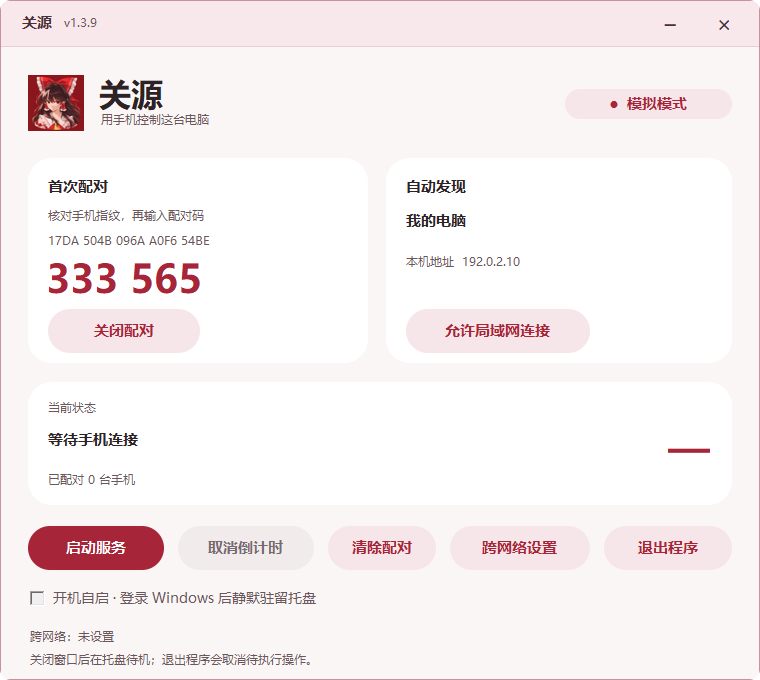

# 关源 GuanYuan

用 Android 手机控制自己的 Windows 电脑关机、睡眠或休眠。手机在同一局域网可自动发现电脑，也可通过移动数据连接已配置的电脑。电源操作需要确认，提交后有 30 秒倒计时，两端均可取消。

## 下载

| 客户端 | 系统 | 当前版本 |
| --- | --- | --- |
| Windows | Windows 10 或 11，64 位 | [v1.3.9 ZIP](https://github.com/Cherishia/GuanYuan/releases/download/v1.3.9/GuanYuan-Windows-v1.3.9.zip) |
| Android | Android 8.0 及以上 | [v1.3.7 APK](https://github.com/Cherishia/GuanYuan/releases/download/v1.3.9/GuanYuan-Android-v1.3.7.apk) |

两个客户端独立编号，可以搭配使用。发布页还提供文件的 SHA-256 校验值。[v1.3.9 发布页](https://github.com/Cherishia/GuanYuan/releases/tag/v1.3.9)

## 界面

Windows 使用浅色标题栏、抗锯齿圆角和加大的按钮。鼠标点击显示按压反馈，使用 Tab 切换按钮时显示圆角焦点提示。Android 将电脑状态、电源操作和连接管理分组，按钮支持原生涟漪反馈。

[查看 Windows 圆角像素对比](docs/windows-corner-comparison.png)

## 安装和升级

1. Windows 完整解压 ZIP，再打开 `GuanYuan.exe`。若旧版在运行，先右键任务栏托盘里的关源图标并选「退出」。窗口右上角的关闭键会将程序收起到托盘。
2. Android 安装 APK。已有新版签名的关源可直接覆盖安装，从 v1.3 及以上升级可保留配对。早于 v1.3 的配对需要重新建立。
3. 如需开机自启，把电脑端放在固定目录并勾选「开机自启」。改用新目录后重新勾选，必要时点「允许局域网连接」。

[Windows 使用说明](Windows/使用说明.txt) · [Android 更新说明](Android/更新说明.txt)

## 局域网配对与控制

1. 让手机和电脑连入同一路由器。电脑打开关源并运行服务，必要时点「允许局域网连接」。
2. 电脑点「开始配对」。在手机选择发现的电脑，逐组核对两端身份指纹，再输入电脑端显示的 6 位配对码。配对入口在成功后关闭，未完成时 5 分钟后关闭。
3. 手机收到电脑状态后，选择关机、睡眠或休眠并确认。若自动发现失败，可在手机手动输入电脑端显示的 IPv4 地址。

电脑需要开机、联网并在后台运行关源才能接收指令。睡眠与休眠由 Windows 和硬件支持情况决定。请在关机前保存文件。

## 通过手机流量连接

1. 电脑打开「跨网络设置」，点击「一键开启免服务器模式」，等待电脑显示已连接。
2. 让手机在同一 Wi-Fi 下连接这台电脑一次，同步加密的远程入口。
3. 手机切到流量，从列表打开已保存的远程入口，点「通过网络连接」。先确认收到电脑状态，再提交操作。
4. 若需关闭，在电脑点击「关闭跨网络」。可在手机重新同步或移除已保存的远程入口。

免服务器模式使用 ntfy 公共中转，连通性和配额会影响响应。页面的「检测手机网络」只验证手机与公共中转之间的消息收发。按「重新连接（查询状态）」可确认电脑是否已响应，特别是在提交电源操作却未收到回执时。

需要自有中转时，可使用仓库提供的 HTTPS 部署配置。[自有中转配置](Relay/README.md) · [配对与加密说明](安全说明.md)

## 构建与验证

- Windows 为原生 C++ / Win32，Android 为原生 Java。代码位于 `Source/Native` 和 `Source/Android`。
- 构建用 Zig 0.13.0、JDK 17、Android SDK 35 和 Build Tools 35.0.0。运行 `Source/Build.ps1` 并传入 `-ZigDir`、`-JdkDir`、`-BuildToolsDir`、`-AndroidJar` 和 `-BuildDir`。只构建 Windows 时可加 `-WindowsOnly`，省略 Android 工具参数。自行构建 APK 时应保管自己的签名密钥。
- 本版通过 Windows 界面、局域网发现和配对、私有中转、ntfy 模拟联调。电源操作使用模拟执行器。真实手机流量到家庭 Wi-Fi 的电源操作仍待实机验证。Windows 包里的 `TrySimulation.cmd` 可用于演练。

[验证记录](Validation/README.txt) · [历史性能测量](性能实测.md)
